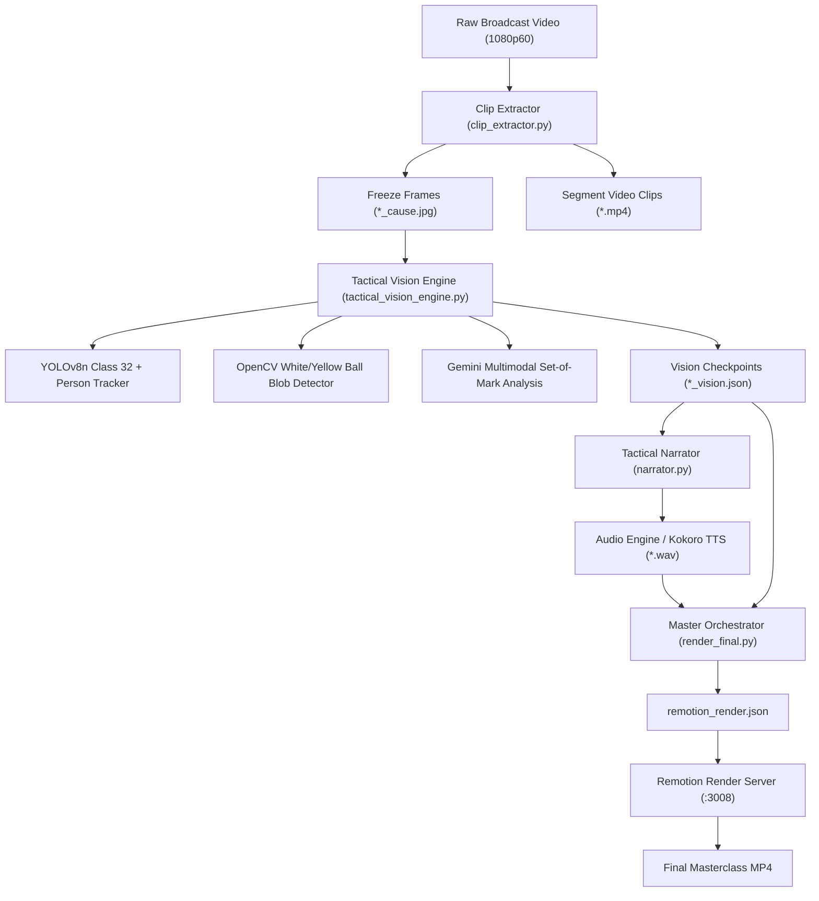

# Tactical Masterclass Video Engine — Developer Handover Guide

> **Note**: This document contains everything needed to set up, understand, debug, and run the automated **Tactical Masterclass Video Engine** (Roma vs Real Madrid UEFA Champions League tactical breakdown).

---

## 1. Project Overview & Architecture

The system transforms raw football broadcast footage into broadcast-grade tactical analysis videos (Sky Sports / The Coaches' Voice style):
1. Slices relevant tactical events with precise moving pre-roll.
2. Tracks players, ball, and pitch geometry using YOLOv8, OpenCV, and Gemini Multimodal Set-of-Mark.
3. Generates 3-beat tactical commentary and synthesizes audio with Kokoro TTS.
4. Teleports tracking data into a React / Remotion composition.
5. Renders high-frame-rate video overlays (freeze-frames, telestration beams, tactical networks, exploit zones, and live-pitch tracking) in Docker.



---

## 2. Directory Structure & Key File Paths

### Core Repository (`C:\Users\mlkme\Desktop\cursor-mikow\`)
* `render_final.py`: Main pipeline entry point. Runs vision analysis, commentary generation, validation suites, and dispatches the render to Remotion.
* `debug_ball_carrier.py`: Standalone 5-second debugger that tests ball and ball-carrier detection across all 5 clips and generates a visual contact sheet.
* `src/vision/tactical_vision_engine.py`: Vision and tactical telestration core (YOLOv8 tracking, KMeans jersey clustering, Set-of-Mark annotation, temporal motion difference, exploit quad generation).
* `src/ingestion/clip_extractor.py`: Video ingestion and slicing module with physical pre-roll alignment.
* `src/pipeline_runner.py`: Pipeline execution orchestrator.
* `src/narration/`: Tactical script generation prompt chains.
* `src/audio/`: Kokoro TTS audio generation and audio beat gap alignment.

### Remotion Server (`C:\Users\mlkme\Desktop\cursor-mikow\remotion-server\`)
* `remotion-server/src/compositions/TacticalMasterclass.tsx`: Top-level composition sequencing all 5 tactical segments.
* `remotion-server/src/compositions/components/TacticalTelestrationOverlay.tsx`: 3-sequence tactical overlay component:
  * **Sequence 1 (`0 to K`)**: Live moving footage before the freeze.
  * **Sequence 2 (`K to K + freezeDuration`)**: Telestration freeze-frame with spotlight beams, player rings, exploit quads, cyan lines, and pass/run vectors.
  * **Sequence 3 (`K + freezeDuration to End`)**: Resumed live footage showing the execution and goal/outcome with real-time player tracking rings.

### Assets & Checkpoints (`F:\DockerRenders\`)
* `F:\DockerRenders\assets\clips\`: Sliced 1080p MP4 clips (`clip_01_left_wing.mp4` through `clip_05_right_wing.mp4`).
* `F:\DockerRenders\assets\frames\`: Pristine freeze-frame images (`clip_01_left_wing_cause.jpg`, etc.).
* `F:\DockerRenders\assets\audio\`: Generated WAV commentary files (`beat_1_setup.wav`, `beat_2_breakdown.wav`, `beat_3_resolution.wav`).
* `F:\DockerRenders\checkpoints\roma_vs_real_madrid\`: Cached vision and audio JSON state files.
* `F:\DockerRenders\Tactical_Masterclass_Clean_V4.mp4`: Final rendered broadcast video.
* `F:\DockerRenders\ball_carrier_debug.jpg`: 5-panel verification sheet of ball & carrier detections.

---

## 3. Server & Docker Setup

The system relies on two network services:

### 1. Static Asset Server (Port 3000)
Hosts video clips, frames, and audio for Remotion rendering.
```powershell
# From C:\Users\mlkme\Desktop\cursor-mikow:
python -m http.server 3000 --directory F:/DockerRenders
```
Remotion references assets via `http://127.0.0.1:3000/assets/...` or container-accessible endpoints.

### 2. Remotion Docker Render Server (Port 3008 -> 3000)
A Docker container named `cursor-mikow-remotion` runs the Node.js Remotion renderer.
* Host Port: `3008` (Mapped to container port `3000`)
* Render Endpoint: `http://127.0.0.1:3008/render`
* Status Endpoint: `http://127.0.0.1:3008/progress/{renderId}`

**How to sync changes and rebuild Remotion**:
```powershell
# 1. Copy updated TypeScript files into the container:
docker cp remotion-server/src/. cursor-mikow-remotion:/app/src/

# 2. Rebuild the Remotion bundle:
docker exec cursor-mikow-remotion npm run build

# 3. Restart the container to reload the build:
docker restart cursor-mikow-remotion
```

---

## 4. Key Mathematical Rules & Invariants

When modifying or extending this engine, the following invariants **must never be broken**:

### 1. Pre-Roll Synchronization Invariant ($T_{preroll} == V_{freeze} == K$)
* In `TacticalTelestrationOverlay.tsx`, `Sequence 1` (moving preroll) duration is set to $K$ frames.
* The physical video frame of ball contact extracted from the clip **must be exact frame $K$**.
* Never set `<OffthreadVideo endAt={X}>` with $X < K$, or Remotion will render black frames for the remainder of Sequence 1.

### 2. White-Sock & Pitch-Line Suppression
* In `detect_ball_and_carrier()`, player bounding boxes `[ymin:ymax-2px]` are blacked out before finding circular white blobs. This prevents Real Madrid white socks from registering as the football.
* Straight pitch lines are suppressed using morphological openings (`25x2`, `2x25`) and Hough line dilation.
* Set-of-Mark `[ID]` badges must be placed **above the player's head (`b_y1 - 10`)**, never over their boots.

### 3. Geometry Rules
* **Yellow Exploit Zone**: Must always be a 4-point quadrilateral (formed from 4 quadrant defenders scaled inward 25% and polar sorted). Delaunay triangulation is banned. Pairwise edge distance must be $\ge 4.0\%$.
* **Cyan Structural Network**: Must always resolve $\ge 3$ same-team outfield defending players physically present in `tracks_per_frame`.

---

## 5. Standard Developer Workflow & Commands

### A. Quick Ball & Carrier Check (~5 seconds)
Verify YOLO and blob detection without rendering video:
```powershell
python debug_ball_carrier.py
```
Check visual results in `F:\DockerRenders\ball_carrier_debug.jpg`.

### B. Python Syntax & Compilation Check
```powershell
python -m py_compile src/vision/tactical_vision_engine.py src/ingestion/clip_extractor.py src/pipeline_runner.py render_final.py debug_ball_carrier.py
```

### C. Run Full End-to-End Render Pipeline
```powershell
python render_final.py
```
This runs vision analysis, commentary generation, pre-render verification checks, Remotion container rendering, and OpenCV luminance / black frame audits. Output is saved to `F:\DockerRenders\Tactical_Masterclass_Clean_V4.mp4`.
