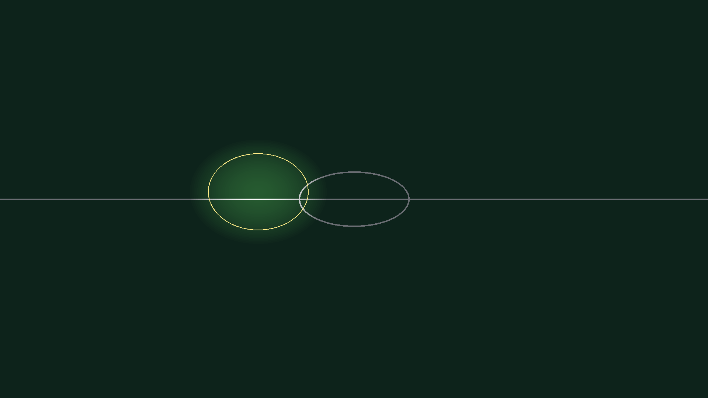
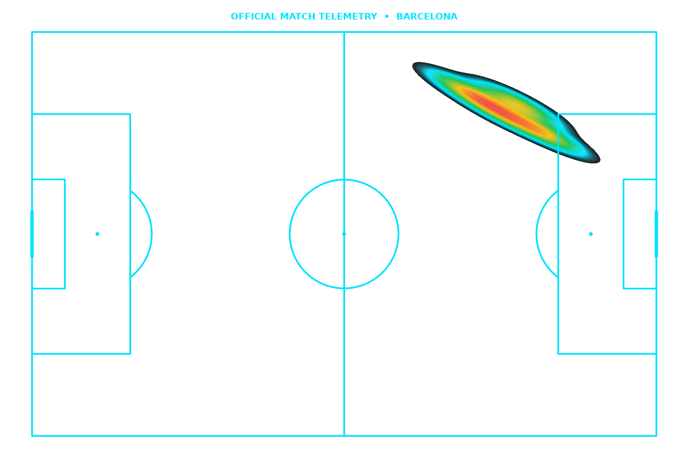
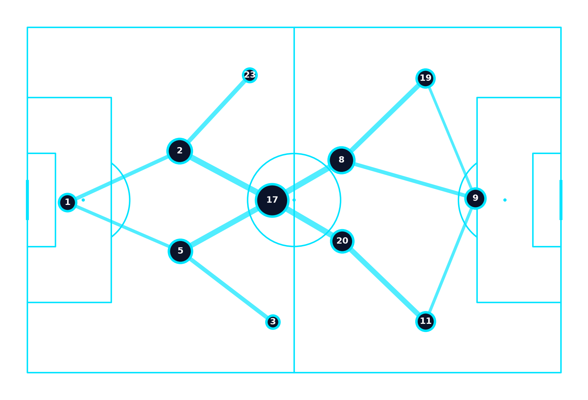

# ⚽ Football Analysis Generator — Tactical Masterclass & Broadcast Vision AI

<div align="center">

[](https://python.org)
[](https://opencv.org)
[](https://ai.google.dev)
[](https://n8n.io)
[](https://remotion.dev)
[](LICENSE)

**An autonomous AI vision pipeline and tactical studio transforming raw football match broadcast footage into professional tactical breakdowns, player tracking overlays, and broadcast-grade telestrations.**

[Overview](#-overview) • [Visual Outputs](#-broadcast-grade-tactical-telestrations--visual-outputs) • [Key Capabilities](#-key-capabilities) • [Pipeline Walkthrough](#-two-pass-vision-pipeline-execution) • [Quick Start](#-quick-start) • [Control Room](#-interactive-tactical-control-room)

</div>

---

## 📋 Overview

Television tactical analysis (e.g. Sky Sports' Monday Night Football, Match of the Day) requires sophisticated telestration: highlighting player positioning, projecting pass vectors, drawing defensive cover shadows, and calculating team press intensity.

**Football Analysis Generator** brings broadcast-grade tactical telestration to automated pipelines:
1. Detects and tracks 22 outfield players and the ball with sub-pixel turf anchoring.
2. Resolves real player identities (e.g., Lamine Yamal, Raphinha, Lewandowski) dynamically via jersey numbers, kit color clustering, and tactical formation geometry.
3. Renders perspective-correct floor rings, volumetric spotlights, motion breadcrumb trails, and glassmorphic HUD cards.
4. Generates tactical commentary, audio voiceovers, and synchronizes broadcast sound effects.

---

## 📸 Broadcast-Grade Tactical Telestrations & Visual Outputs

<div align="center">

### 1. Volumetric Spotlights & Player Floor Rings


*Perspective-correct 3D pitch homography rendering volumetric spotlights and anchored floor rings under tracked players with sub-pixel turf grounding.*

---

### 2. Tactical Heatmaps & Pass Networks
<p align="center">
  
  
</p>

*Left: Dynamic spatial density heatmap generated for Lamine Yamal (Right Flank / Half-Space Penetration). Right: Passing network graph reflecting progressive ball progression and player connectivity.*

</div>

---

## ⚡ Key Capabilities

- 🌱 **Sub-Pixel Turf Grounding**: Local OpenCV spatial detection eliminates coordinate drifting and hallucinated positions on grass.
- 💡 **Perspective Floor Rings & Spotlights**: Pitch homography maps 2D image coordinates to authentic 3D pitch planes, generating volumetric illumination under selected players.
- 🏃 **Continuous Multi-Object Tracking (MOT)**: Tracks player trajectories across successive buildup frames ($T_0 \dots T_4$) with velocity estimation in km/h and motion breadcrumb splines.
- 🤖 **Two-Pass Hybrid VLM Integration**: Couples fast local player proposals with a single batched sprite montage call to Gemini Vision, bypassing API rate limits while retaining maximum visual clarity.
- 👥 **Dynamic Non-Hardcoded Rosters**: Reconciles lineups directly from official rosters, automatically assigning kit colors, squad numbers, and positional bounds.
- 🖥️ **Interactive Tactical Control Room**: Zero-install HTML5/JS dashboard featuring real-time scrubber controls, layer toggles (rings, breadcrumbs, vectors, cards), and side-by-side buildup vs. outcome analysis.

---

## 🔬 Two-Pass Vision Pipeline Execution

| Stage | Subsystem | Action & Technique |
|:------|:----------|:-------------------|
| **Frame Ingestion** | Ingestion Engine | Sparse clock OCR slices key buildup frames ($T_0 \dots T_4$) around shots, progressive carries, and turnovers. |
| **Pass 1: Local MOT** | OpenCV + Bot-SORT | Sub-pixel turf mask filtering detects player bounding boxes; Bot-SORT assigns persistent track IDs; K-means clusters team kit colors. |
| **Pass 2: VLM Identification** | Gemini 2.5 Flash | Single-call sprite collage passes cropped jerseys to Gemini Vision, extracting squad numbers and visual traits without API rate-limit stalls. |
| **Bijective Resolution** | Hungarian Matching | Reconciles visual proposals against official match rosters, enforcing a 1-to-1 bijection of starting XI and tactical roles. |
| **Broadcast Overlays** | Tactical Studio | Projects perspective floor rings, motion breadcrumb splines, speed readouts (km/h), and aerodynamic pass curves. |

---

## 🚀 Quick Start

### 1. Prerequisites
- **Python**: 3.11+
- **FFmpeg**: Configured on system `PATH`
- **Google Gemini API Key**

### 2. Installation

```bash
# Clone the repository
git clone https://github.com/Maliksouhildev/football-analysis-generator.git
cd football-analysis-generator

# Install Python dependencies
pip install -r requirements.txt 2>/dev/null || pip install opencv-python numpy pillow requests google-genai pyyaml
```

### 3. Setup Environment Variables

```bash
cp .env.example .env
```
Edit `.env`:
```ini
GEMINI_API_KEY=your_gemini_api_key_here
PORT=5055
```

### 4. Run the Pipeline on Video

To process a match video file with automated player tracking and tactical telestrations:

```bash
python scripts/run_video_pipeline.py --input match_clip.mp4 --output tactical_masterclass.mp4
```

### 5. Launch the Tactical API Server & Dashboard

Start the local server listening on port `5055`:

```bash
python vision_pipeline/api_server.py
```

Now double-click or open [`dashboard/index.html`](dashboard/index.html) in any modern web browser to interact with the Tactical Control Room.

---

## 🖥️ Interactive Tactical Control Room

The bundled [`dashboard/index.html`](dashboard/index.html) is an interactive control room for tactical analysts:
- **5-Stage Scrubber**: Move through sequence frames from defensive buildup to shot execution.
- **Layer Visibility Toggles**: Toggle floor rings, velocity meters, breadcrumbs, and floating identity HUDs.
- **Side-by-Side Verification**: Inspect raw broadcast footage against annotated tactical feeds.

---

## 🧪 Testing & Evaluation Suite

Run the automated prompt and model sweep evaluation harness:

```bash
python vision_pipeline/eval_loop.py
```

Run test suite:

```bash
python -m unittest discover -s tests
```

---

## 📄 Contributing & License

Contributions, tactical enhancements, and pull requests are welcomed.

Distributed under the **MIT License**. Created & maintained by [Maliksouhildev](https://github.com/Maliksouhildev).
